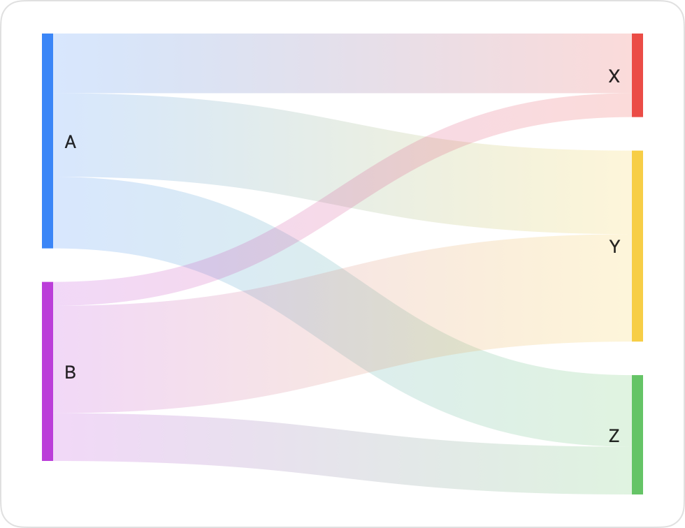

#### About

Native Sankey diagrams in SwiftUI

#### Quickstart



```swift
import Sankey
import SwiftUI

struct QuickStartView: View {
    let data = SankeyData(
        nodes: [
            SankeyNode("A", color: .blue),
            SankeyNode("B", color: .purple),
            SankeyNode("X", color: .red),
            SankeyNode("Y", color: .yellow),
            SankeyNode("Z", color: .green),
        ],
        links: [
            SankeyLink(5, from: "A", to: "X"),
            SankeyLink(7, from: "A", to: "Y"),
            SankeyLink(6, from: "A", to: "Z"),
            SankeyLink(2, from: "B", to: "X"),
            SankeyLink(9, from: "B", to: "Y"),
            SankeyLink(4, from: "B", to: "Z"),
        ]
    )
    
    var body: some View {
        SankeyDiagram(data)
            .linkColorMode(.gradient)
            .padding(10)
            .frame(height: 350)
    }
}

#Preview {
    QuickStartView()
}
```

Find more examples in the [Demo app](Demo/Demo.xcodeproj)

#### Installation

In Xcode: **File → Add Package Dependencies…** and enter `https://github.com/maxhumber/Sankey`

#### Usage

Customize `SankeyDiagram` with simple modifiers:

```swift
SankeyDiagram(data)
    .nodeAlignment(.justify)
    .nodeWidth(8)
    .nodePadding(24)
    .nodeDefaultColor(.gray.opacity(0.8))
    .linkDefaultColor(.gray)
    .linkOpacity(0.3)
    .linkColorMode(.gradient)
    .labelPadding(8)
    .font(.body)
    .frame(height: 320)
```

#### Selection

Bind a node ID to enable selection and connected-flow highlighting:

```swift
@State private var selectedNodeID: String?

SankeyDiagram(data)
    .nodeSelection($selectedNodeID)
```

#### Migrating to 3.0

3.0 requires Swift 6.4+ and iOS/macOS 27+ and has several important changes, notably:

| 2.0 | 3.0 |
|---|---|
| `SankeyDiagram(_ links:, …)` | `SankeyDiagram(SankeyData(nodes:links:))` |
| `SankeyLink(source:target:value:)`, `["A", "B", 5]` | `SankeyLink(5, from: "A", to: "B")` |
| `.nodeOpacity(0.8)` | `.nodeDefaultColor(.gray.opacity(0.8))` |
| `.labelColor(_:)`, `.labelOpacity(_:)` | `.foregroundStyle(_:)` |
| `.labelFontSize(_:)`, `.labelFontFamily(_:)` | `.font(_:)` |
| Nodes at 60% and labels at 80% opacity | Colors as given |
| Duplicate node IDs, negative or non-finite values | "Diagram unavailable" |
| `Encodable`, enum `rawValue` | Removed |

Apply `.font` and `.foregroundStyle` after the Sankey modifiers.
